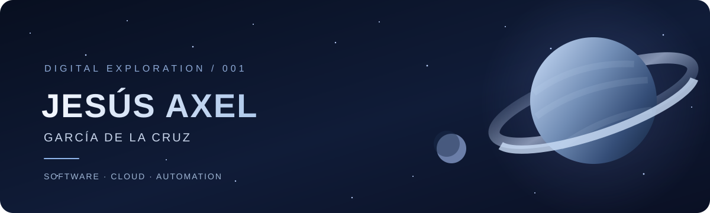

# Jesús Axel García de la Cruz

### Computational Sciences Engineering Student
#### Software Development · Cloud Computing · Automation · Power Platform

 

 

  

*Exploring technology. Building solutions. Connecting ideas.*

---

## 01 / 🌌 About Me

I'm a **Computational Sciences Engineering student** passionate about software development, cloud computing, process automation, and enterprise technology.

My interests go beyond writing code. I enjoy understanding how technology can improve **business processes, organizational operations, and everyday workflows**.

I combine technical knowledge with an interest in **business administration, digital transformation, and technology management**, allowing me to approach projects from both engineering and organizational perspectives.

My main areas of interest include:

- **Software Engineering:** Backend development, REST APIs, and application architecture.
- **Cloud Computing:** AWS, Google Cloud Platform, and Microsoft Azure.
- **Business Automation:** Microsoft Power Platform and Microsoft 365.
- **Data & Databases:** Relational databases, data analysis, and intelligent algorithms.
- **Enterprise Technology:** Digital collaboration, administration, and process optimization.

---

## 02 / 🪐 Technology Universe

### Planet 01 — Software Development

  

`Java` · `Spring Boot` · `Python` · `JavaScript` · `HTML` · `CSS` · `Git` · `REST APIs`

 

### Planet 02 — Cloud & Infrastructure

  

`AWS` · `Google Cloud Platform` · `Microsoft Azure` · `Linux`

 

### Planet 03 — Databases & Data

  

`MySQL` · `PostgreSQL` · `Drizzle ORM` · `SQL` · `Data Analysis`

 

### Planet 04 — Microsoft Ecosystem

 

  

`Power Platform` · `Workflow Automation` · `Business Applications` · `Enterprise Administration`

---

## 03 / 🛰️ Mission Log — Featured Projects

### Citizen Reporting Platform

**Java · Spring Boot · MySQL · Spring Security · Leaflet**

A web application designed to help citizens report and track public service incidents such as water leaks, power outages, and infrastructure problems.

**Key features:**
- User registration and email verification.
- Authentication and role-based access.
- RESTful API development.
- Geographic location selection using interactive maps.
- Relational database integration.
- Incident tracking and management.

**Focus:** Backend engineering, application security, relational databases, and geolocation.

---

### Business Process Automation

**Power Apps · Power Automate · SharePoint · Microsoft 365**

Business-oriented applications and automation workflows designed to simplify administrative operations and improve organizational productivity.

**Areas explored:**
- Digital request and approval processes.
- Workflow automation using Power Automate.
- SharePoint-based data management.
- Business application development with Power Apps.
- Integration between Microsoft 365 services.

**Focus:** Enterprise automation, digital workflows, and operational efficiency.

---

### Data Analysis & Intelligent Systems

**Python · Pandas · Data Mining · Algorithms**

Projects focused on discovering patterns, processing information, and using computational methods to support decision-making.

**Areas explored:**
- Exploratory data analysis.
- Association rule mining using Apriori.
- Data visualization.
- Optimization algorithms.
- Computational intelligence.

**Focus:** Analytical thinking, intelligent algorithms, and data-driven solutions.

---

### Cloud & Infrastructure

**AWS · GCP · Azure · Linux**

Practical experience and academic projects exploring cloud infrastructure, identity management, and system administration.

**Areas explored:**
- AWS Identity and Access Management.
- Cloud infrastructure fundamentals.
- Linux administration.
- Access control and permissions.
- Enterprise cloud platforms.

**Focus:** Cloud architecture, infrastructure, and security fundamentals.

---

## 04 / 📡 Galactic Activity

  

---

## 05 / 🌠 Current Exploration

Technology is constantly evolving, and so is my learning journey.

These are some of the areas I'm currently exploring and strengthening:

- **Software Architecture:** SOLID principles, design patterns, and maintainable applications.
- **Backend Development:** Java, Spring Boot, REST APIs, and database integration.
- **Cloud Computing:** AWS, Google Cloud Platform, and Azure services.
- **Enterprise Automation:** Microsoft Power Platform, Copilot Studio, and Microsoft Graph.
- **Data & Intelligent Systems:** Data mining, optimization, and intelligent algorithms.
- **Cybersecurity:** Cryptography, secure systems, and post-quantum security concepts.

---

## 06 / 🚀 What Drives Me

I believe technology becomes truly valuable when it solves meaningful problems.

Whether it's developing a backend system, automating a repetitive process, exploring cloud infrastructure, or analyzing data, I'm interested in understanding how different technologies can work together to create practical solutions.

My goal is to continue growing as an engineer while connecting **software development, cloud technologies, and business needs**.

---

## 07 / 🌍 Ground Control — Contact

### Let's Connect

I'm always open to connecting with people who share an interest in technology, software development, cloud computing, and innovation.

 

  

  

*“Technology is an expanding universe of possibilities. There's always something new to explore, understand, and build.”*

 

**END OF TRANSMISSION**

✦ · · · ✧ · · · ✦

